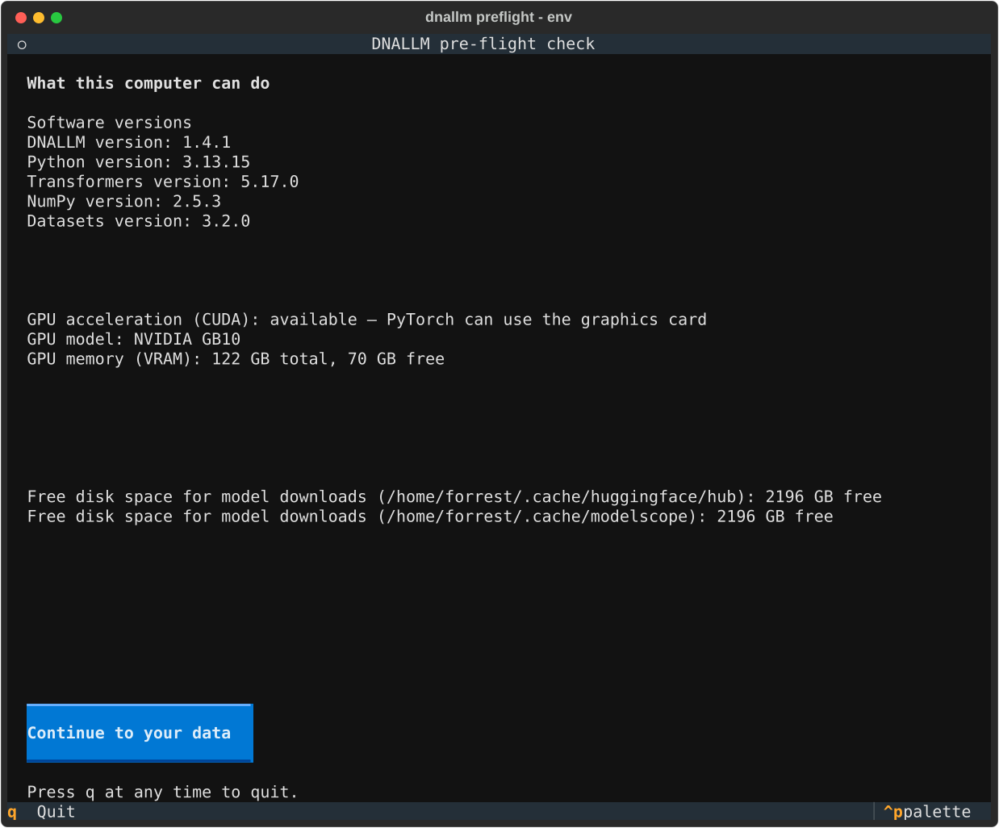
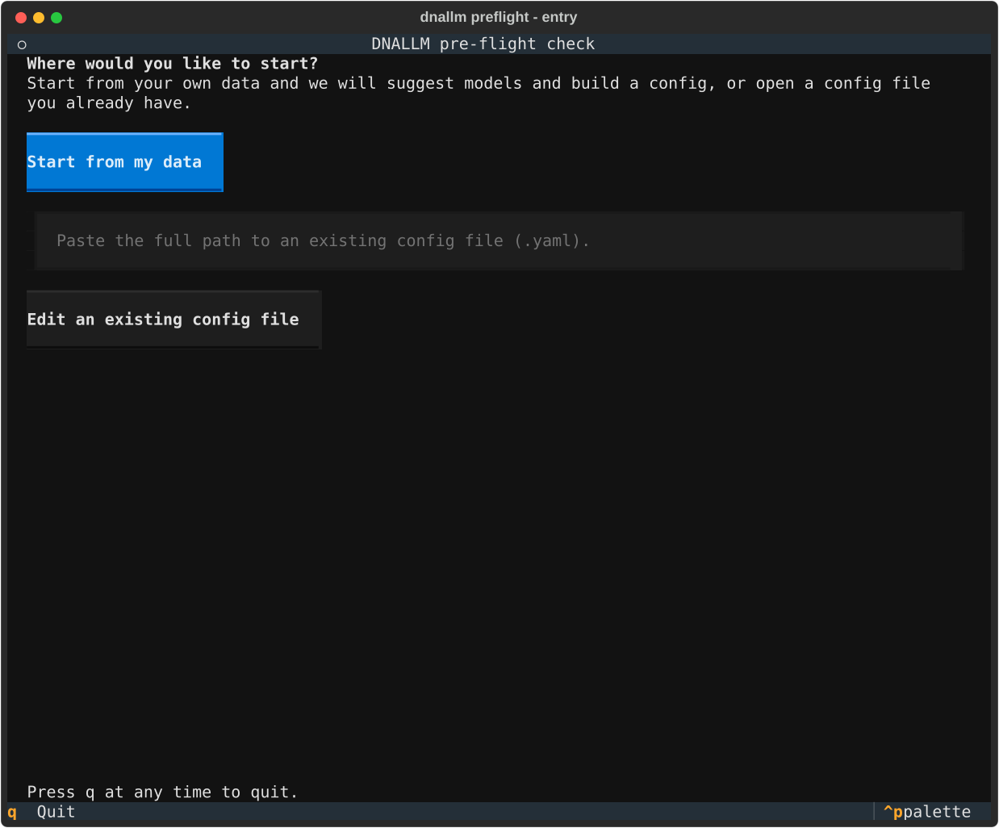
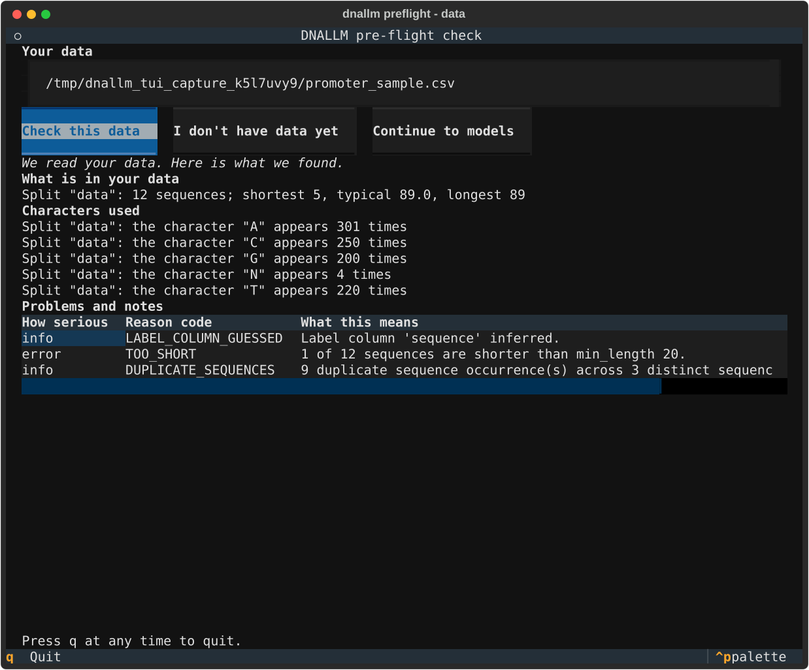
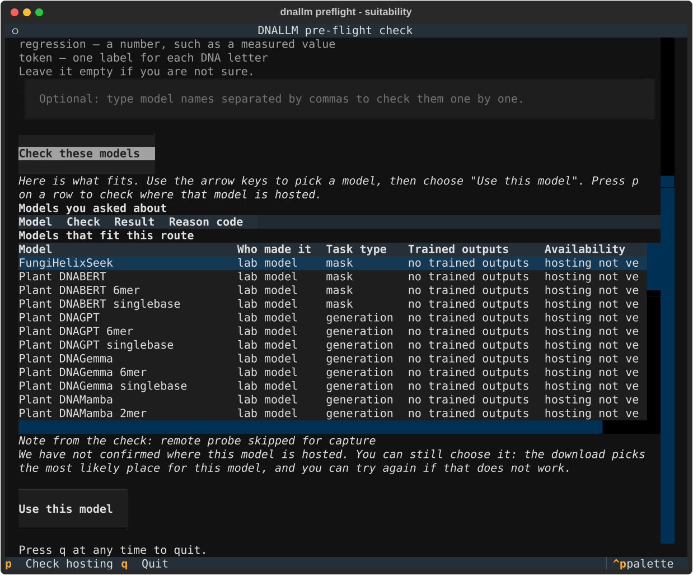
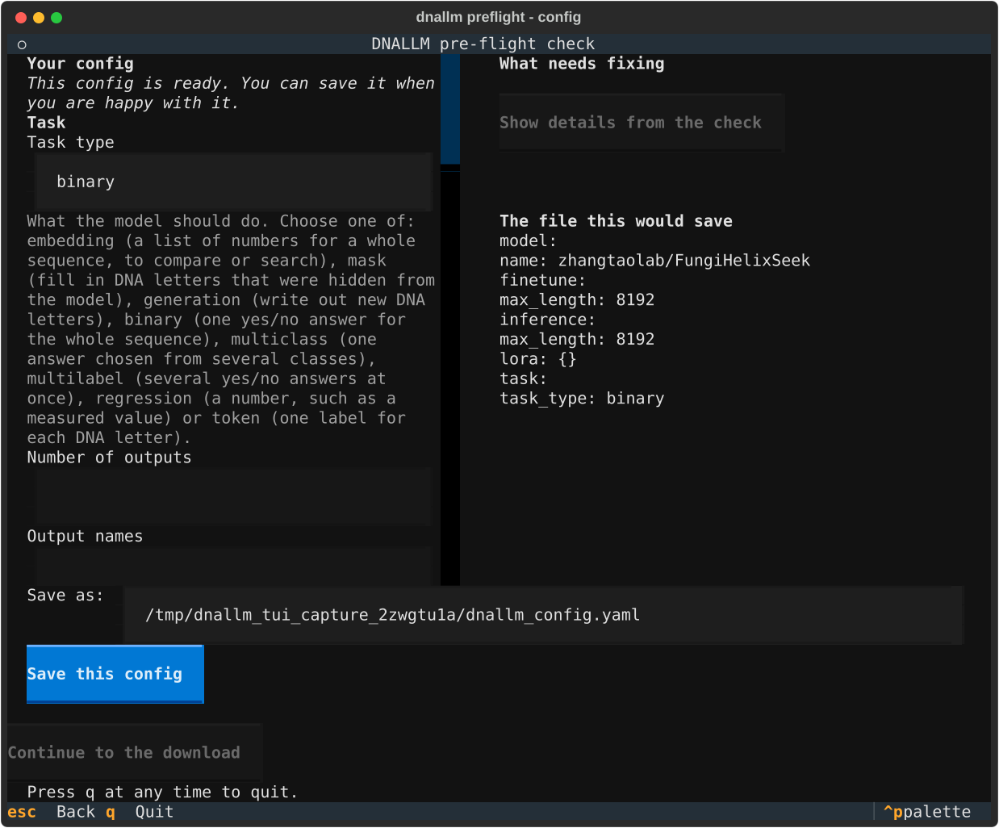
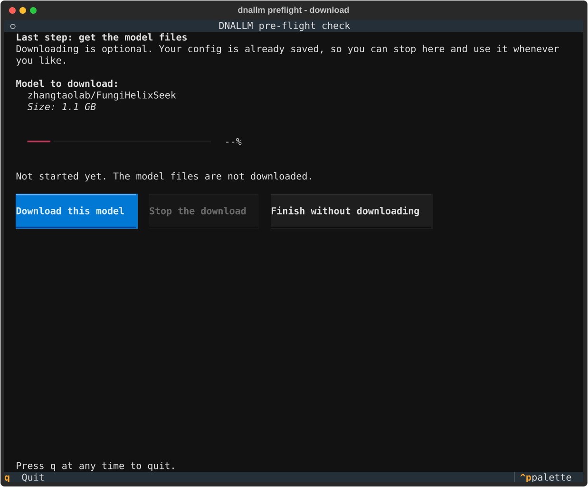
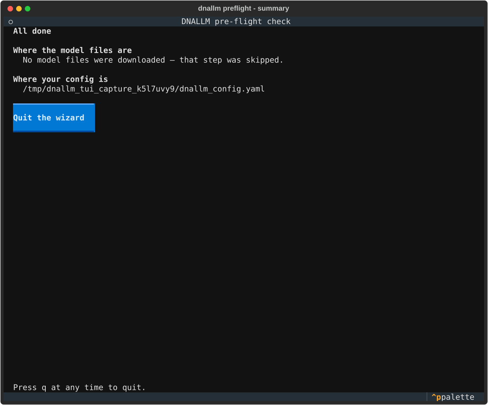

<!-- generated-by: gsd-doc-writer -->

# Pre-flight Wizard (`dnallm preflight`)

The pre-flight wizard is an interactive terminal program that walks you from
*your own data* to a ready-to-use config file — checking along the way that
your sequences and your chosen model will actually work together, before you
download anything or write any YAML by hand. It is aimed at biologists and
bioinformaticians who would rather answer plain questions than read a
configuration reference.

Two promises the wizard keeps:

- **Your data is never touched.** It reads your file, reports what it found,
  and never rewrites, deletes, or "fixes" anything. The only thing it writes
  is the config file you explicitly save at the end.
- **The verdicts are not the wizard's opinion.** Every OK / WARN / FAIL you
  see is computed by the library's pre-flight checks
  ([`dnallm.preflight`](../../architecture/overview.md#34-pre-flight-raw-data-validated-config));
  the screens only display them.

## Install and launch

The wizard ships as an optional extra — Textual is its only additional
dependency, and the rest of the toolkit works fine without it:

```bash
pip install "dnallm[tui]"
```

Then start it:

```bash
dnallm preflight                        # start from your own data
dnallm preflight --config my.yaml       # jump straight to editing an existing config
```

On a core-only install, `dnallm preflight` prints a one-line install hint
instead of a stack trace.

## The seven screens

### 1. What this computer can do

The first screen reports the environment: DNALLM, Python, transformers, NumPy
and datasets versions, whether a GPU is visible (and which model, with how
much memory), and how much free disk space the model-download folders have.
Nothing here is a test you can fail — it is context for the choices that
follow, e.g. whether a 1 GB model is a realistic download on this machine.



### 2. Where would you like to start?

Two entry paths:

- **Start from my data** — the full flow described below: check your data,
  get model suggestions, build a config.
- **Edit an existing config file** — paste the path to a YAML file and the
  wizard opens it on the config screen with live validation.

Passing `--config my.yaml` at launch skips this choice and opens the file
directly.



### 3. Your data

Paste the full path to your data file (CSV, TSV, JSON, FASTA or TXT).
The wizard reads it and reports, in plain numbers: how many sequences, the
shortest / typical / longest lengths, which characters appear (including
non-ACGT letters such as `N`), and any findings — duplicate sequences,
too-short sequences, degenerate bases — each with the affected rows. In the
screenshot below, the sample file contains 12 sequences; the check found one
5-letter sequence and duplicate rows, and counted 4 `N` characters.



If you do not have data yet ("I don't have data yet"), the wizard skips the
check and still lets you browse models and build a config.

### 4. Which models fit

This screen asks what you plan to do — *fine-tune* (teach a model your task)
or *predict* (use a model as-is) — and which task type that means (binary:
two classes; multiclass: several classes; regression: a number; token: one
label per DNA letter; embedding: numbers describing a whole sequence; mask:
fill in hidden letters; generation: write new sequence). Each option is
glossed in the same plain terms.

Leave the model list empty to see the whole registry listing ordered by
fit, or type specific model names to check them one by one. Every row shows
whether the model's files are already on this machine. Move with the arrow
keys; press <kbd>p</kbd> on a row to check where that model is hosted (an
on-demand network lookup — without it, the wizard stays offline); then choose
"Use this model".



### 5. Your config

The chosen model is turned into a config file you can review and edit before
anything is saved. The form shows each field with a plain-language label and
hint; facts that come from the model itself (such as its maximum sequence
length, filled in from the model registry) are read-only — the wizard will
not let a config contradict the model it names.

The right-hand pane validates **live**: while anything needs fixing, saving
stays switched off and the pane says exactly what to change ("Show details"
expands each problem). When the list is empty, the pane reads "This config is
ready" and the exact file that would be saved is previewed at the bottom.



For a base model (one with no built-in task), you choose the task type here —
in the screenshot, `binary` was entered and the validation list emptied. For
a fine-tuned registry model, the task type arrives pre-filled and read-only,
together with its label settings.

Press "Save this config" to write the file to the path shown above the
button. Saving is atomic: a half-written file can never replace an existing
one.

### 6. Get the model files (optional)

After a save, the wizard offers to download the model you chose — with the
size shown up front (1.1 GB for the model in this walkthrough) and live
byte progress. This step is optional: the config is already saved, so
"Finish without downloading" is always a valid end. The download runs in the
background and can be stopped; a stopped download is reported as stopped,
never as "nothing was downloaded".



### 7. All done

The summary shows where the model files are (or that the download was
skipped) and the exact path of the saved config.



For this walkthrough the saved file was:

```yaml
model:
  name: zhangtaolab/FungiHelixSeek
finetune:
  max_length: 8192
inference:
  max_length: 8192
lora: {}
task:
  task_type: binary
```

Note that `max_length: 8192` came from the model's registry entry — the
wizard filled it in, it did not guess.

## Keys

| Key | Action |
|-----|--------|
| <kbd>↑</kbd> / <kbd>↓</kbd> | Move through the model listing |
| <kbd>Enter</kbd> | Select the highlighted listing row |
| <kbd>p</kbd> | On a listing row: check where that model is hosted — an on-demand lookup; the wizard makes no other network call unless you start a model download |
| <kbd>q</kbd> | Quit at any time — in-flight background work stops cooperatively |

## Notes for the curious

- The wizard is *presentation-only*: it renders the reports produced by
  `dnallm.preflight` verbatim. Every rule that decides OK / WARN / FAIL lives
  in the library, so programmatic users get identical answers from
  `validate_data` / `check_compatibility` / `generate_config` without a
  terminal.
- Importing the wizard pulls in none of the training stack — it works on
  machines (and installs) without torch.
- The same live validation that gates the save button is what the MCP layer
  and the config reference document; see the
  [Configuration System](../../configuration/configuration.md) for what each
  YAML section means.

## Related pages

- [Configuration System](../../configuration/configuration.md) — what the
  generated YAML sections mean
- [Preset Model Loading](../preset_loading.md) — load the chosen model in one
  Python call
- [Getting Started](../../guides/getting-started.md) — where the wizard fits
  in the 15-minute path
- [Architecture Overview: pre-flight](../../architecture/overview.md#34-pre-flight-raw-data-validated-config)
  — how the wizard and the core checks are separated
